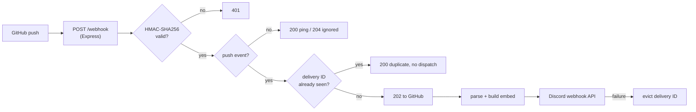

# github-discord-ci

[](https://github.com/ckuudee/github-discord-ci/actions/workflows/test.yml)

A small Node.js/Express service that receives GitHub `push` webhooks and posts a color-coded Discord embed (commit message, author, branch, commit link). Built to be correct about the parts of webhook handling that are easy to get wrong: authenticity, duplicate deliveries, and GitHub's response timeout.

## Architecture



In local development, GitHub cannot reach `localhost`, so [smee.io](https://smee.io) relays deliveries through `smee-client` to `http://localhost:3000/webhook`. The service itself has no dependency on it.

| File | Responsibility |
|---|---|
| `src/server.js` | `POST /webhook`, `GET /health`, delivery cache |
| `src/verifySignature.js` | `X-Hub-Signature-256` check |
| `src/parsePush.js` | push payload to the fields we render |
| `src/discord.js` | embed builder and Discord sender |

Embed colors: green = default branch, blurple = other branch, yellow = force push, red = branch deleted.

## Key decisions

### Security: verify before trusting anything
Anyone who finds the endpoint URL can POST to it. GitHub signs the request body with the shared secret (HMAC-SHA256) and sends it in `X-Hub-Signature-256`. The server recomputes the HMAC and compares with `crypto.timingSafeEqual`, so comparison time doesn't leak how many bytes matched. Requests with a missing or bad signature get `401` and nothing else runs.

The route uses `express.raw()` instead of `express.json()`. The HMAC is computed over the exact bytes GitHub sent, and re-serializing parsed JSON doesn't reproduce them.

### Idempotency: duplicate deliveries must not double-post
GitHub does not promise exactly-once delivery, and a delivery can be redelivered (from the UI or the API) with the same `X-GitHub-Delivery` GUID. The handler keeps an in-memory `Map` of recently seen delivery IDs with a 1-hour TTL. A repeated ID is logged, answered with `200`, and never reaches Discord.

Details that matter:
- The check runs **after** signature verification, so unauthenticated requests can't fill the cache or pre-claim a real delivery ID.
- Every entry has the same TTL, so the Map stays ordered by expiry and the sweep stops at the first live entry. No timers.
- **Failed dispatches are evicted.** If the Discord call fails, the delivery ID is removed, so a manual redelivery after an outage posts the message instead of being dropped as a duplicate.
- A request with no delivery header is processed normally (no dedupe).

### Concurrency: acknowledge first, dispatch after
GitHub treats a webhook as failed if the endpoint doesn't respond within 10 seconds. The handler validates, records the delivery ID, replies `202`, and only then calls Discord asynchronously. A slow or failing Discord can't cause a GitHub-side timeout.

The tradeoff: GitHub sees `202` even when the Discord send later fails, so the failure shows up only in the server log. Recovery is a manual redelivery (see eviction above).

## Local setup

Requires Node 18+ (developed on 22).

```
npm install
```

Copy `.env.example` to `.env`:
- `DISCORD_WEBHOOK_URL`: Discord channel, Settings, Integrations, Webhooks, New Webhook, Copy URL
- `GITHUB_WEBHOOK_SECRET`: any random string, e.g. `node -e "console.log(require('crypto').randomBytes(24).toString('hex'))"`

Both values are credentials. `.env` is gitignored.

Start the server (terminal 1) and check `http://localhost:3000/health`:
```
npm run dev
```

Forward GitHub deliveries (terminal 2). Create a channel at https://smee.io, then:
```
npx smee-client --url <your-smee-channel-url> --target http://localhost:3000/webhook
```

In the GitHub repo, Settings, Webhooks, Add webhook:
- Payload URL: the smee channel URL
- Content type: `application/json`
- Secret: same value as `GITHUB_WEBHOOK_SECRET`
- Events: Just the push event

Then push:
```
git commit --allow-empty -m "test: ci monitor"
git push
```

smee channels are public: anyone with the URL can read the payloads. Use a throwaway repo, not private code.

## Testing

```
npm test
```

Runs 15 tests with Node's built-in runner (`node:test`, no extra dependencies). They cover:
- signature verification: valid, tampered, missing, and malformed signatures
- payload parsing against a real captured push payload (`test/fixtures/push.json`, trimmed, emails removed)
- embed colors and Discord length limits
- the webhook endpoint: `401` on forged requests, `200` on `ping`, `202` on a valid push
- deduplication: same delivery ID sent once, distinct IDs both sent, TTL expiry, no header
- retry recovery: a failed Discord send does not block a redelivery
- an unsigned request cannot poison the delivery cache

The Discord sender is injected, so tests run without network access.

## Failure modes and known limitations

| Situation | Behavior |
|---|---|
| Bad or missing signature | `401`, nothing logged to Discord |
| Duplicate delivery ID within TTL | `200`, logged, not sent |
| Discord down or returns an error | Error logged, delivery ID evicted, GitHub already saw `202`. Redeliver manually. |
| Discord rate limit (`429`) | Treated as a failure: logged with `retry_after`, not retried automatically |
| Server restart (including `node --watch` reloads) | Cache is empty, so a redelivery of an old event is posted again |
| Redelivery after the 1-hour TTL | Posted again |
| Tag pushes, other event types | Ignored (`204`) |

Known limitations:
- **The cache is in process memory.** It resets on restart and isn't shared between instances, so it only works for a single process. A multi-instance deployment needs a shared store, for example Redis with `SET key value NX EX <ttl>`, which also makes the check-and-claim atomic across instances.
- **No retry or queue for Discord.** A failed send is dropped after logging. A queue with backoff would make delivery more reliable; it isn't worth the complexity for a notification feed.
- **Check-then-claim relies on Node's single thread.** It is safe in one process because there is no `await` between the lookup and the insert. This stops being true with an external store.
- **Single repository, push events only.** There is no per-repo or per-branch filtering.
